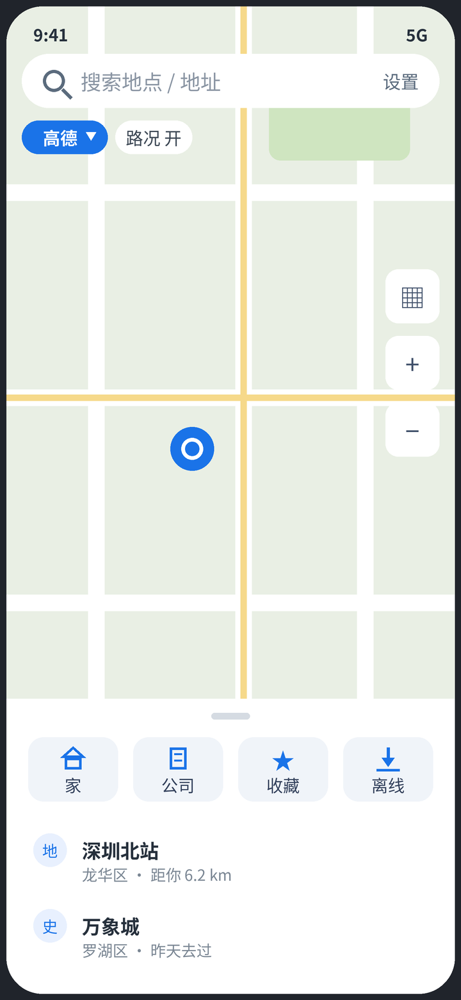
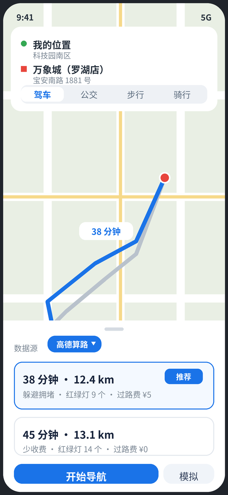
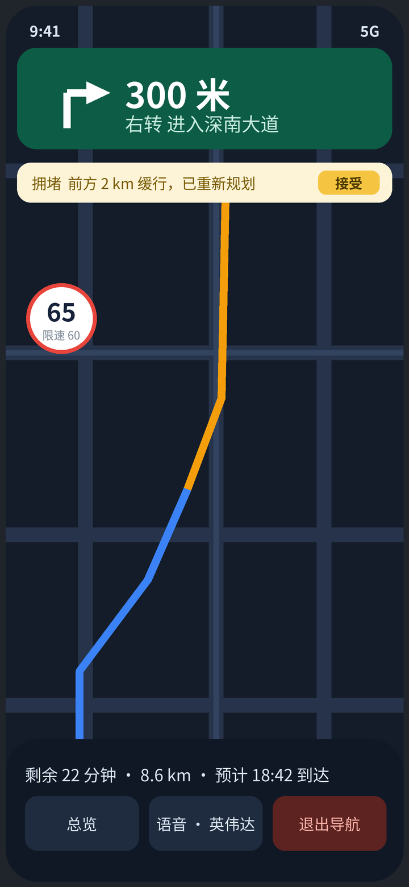

<p align="center">
  
</p>

<h1 align="center">识途 Shitu</h1>

<p align="center">多服务商地图导航：高德底图 + 高德 / 百度 / 腾讯三家搜索算路可切换，Key 由用户自填，英伟达 TTS 可选播报。</p>

「识途」是一款用 Flutter 开发的地图导航应用（Android / iOS 为主）。它不内置任何服务商的 Key：地图底图用高德 Web 瓦片（不需要 Key），地点搜索与路线规划可以在高德、百度、腾讯三家 Web API 之间切换对比，语音播报默认用系统 TTS，也可以填英伟达 API Key 换成 Magpie TTS 的预合成播报。所有 Key 只保存在本机，由用户自己申请、自己填写。

## 界面样板图

> 以下为**设计样板图**（按已批准的产品原型绘制的示意图），**真机截图待补**。

<p align="center">
  
  
  
</p>

从左到右：主页（全屏地图 + 悬浮搜索 + 数据源芯片 + 可拖动底部面板）、路线规划（多方案同图对比、方案卡可切换算路数据源）、导航中（沉浸式指引横幅 + 速度气泡 + 剩余信息条）。

## 功能清单

- **地图底图**：高德 Web 瓦片（flutter_map 渲染：标准/卫星样式、实时路况 overlay、路线 Polyline、POI 标记、定位蓝点），全平台统一、不需要 Key
- **地点搜索**：关键词搜索与联想，三家数据源可切换；无 Key 时展示明确标注的示例数据
- **多方案路线规划**：驾车 / 公交 / 步行 / 骑行；选中路线与备选路线同图对比，方案卡展示时长、距离、过路费、红绿灯数与策略标签（高德驾车用多策略并行请求拼多方案）
- **轻量导航**：跟随式导航界面（指引横幅、速度/限速、拥堵重规划提示、到达小结）
- **语音播报**：系统 TTS（离线可用）；可选英伟达 Magpie TTS（zh-CN 音色），路线播报文案预合成缓存、断网回落系统语音
- **Key 自填**：设置页每家一张 Key 卡（状态点、测试连接验活、「获取 Key」直达控制台、申请指南含包名与 SHA1 一键复制）
- **界面**：Material 3 + 动态取色；手机全屏地图布局，宽屏（≥900px）自动切左栏 + 右地图双栏

## 获取 Key 说明

识途的全部功能都依赖你自己申请的 Key。通用流程是：**注册对应开放平台账号 → 创建应用 → 按下面的说明选对 Key 类型并填好包名/SHA1 → 把 Key 复制回识途设置页对应的卡片里保存**。

- 包名 / Bundle ID 统一填：`com.shitu.app`
- Android 的发布签名 SHA1 在识途「设置 → 申请指南」里可以直接复制（当前为占位值，正式发布包会替换为真实发布指纹）
- 设置页每张 Key 卡下方都有「获取 Key」按钮，可直达对应控制台

### 高德（搜索/算路，必填其一；底图瓦片免 Key）

控制台：<https://console.amap.com/dev/key/app>

1. 注册高德开放平台账号，创建一个应用。
2. 在应用里添加 Key，服务平台选 **「Web 服务」**，得到 **Web Key** → 填回设置页的「高德 Web Key」卡（用于搜索与算路）。
3. 底图使用高德 Web 瓦片，不需要申请 SDK Key。

### 百度（搜索/算路，可选）

控制台：<https://lbsyun.baidu.com/apiconsole/key#/home>

1. 注册百度地图开放平台账号，创建应用，创建一个 **AK**（应用类型选服务端 / Web 服务方向）。
2. 在 AK 的服务启用里打开**地点检索（Place API）**与**路线规划（Direction API）**相关服务。
3. 把 AK 填回设置页的「百度 Web AK」卡。百度返回的坐标是 BD-09，识途内部会自动转成 GCJ-02 显示，不用你处理。

### 腾讯（搜索/算路，可选）

控制台：<https://lbs.qq.com/dev/console/application/mine>

1. 注册腾讯位置服务账号，创建应用，添加一个 Key。
2. 在 Key 的设置里勾选启用 **WebService API**。
3. 把 Key 填回设置页的「腾讯 Web Key」卡。

### 英伟达（TTS 播报，可选）

控制台：<https://build.nvidia.com/settings/api-keys>

1. 在 build.nvidia.com 注册英伟达开发者账号（免费）。
2. 打开上面的 API Keys 页面，生成一个 `nvapi-` 开头的 API Key。
3. 把 Key 填回设置页的「英伟达 TTS Key」卡，并在「语音播报」里把引擎切到英伟达 TTS。免费端点面向原型/个人使用，有速率限制；不填则用系统语音，不影响导航。

## 运行方式

```bash
flutter pub get
flutter run
```

在设置页填好至少一家的 Web Key 后即可使用真实搜索与算路（底图瓦片开箱即用）；不填 Key 时搜索/算路以示例数据模式运行，界面上会有明确标注。

## 版本说明

当前版本 **0.1.0**。版本号不在代码里硬编码：由 `pubspec.yaml` / 构建（tag、CI）注入，应用内可在「设置 → 关于」查看当前运行的版本号与构建号。

## 工程结构

```
lib/
  models/    数据模型（POI、路线方案、服务商枚举）
  services/  设置存储、三家 Web API 实现、坐标转换、TTS 抽象
  widgets/   地图视图、POI 详情面板等组件
  screens/   主页 / 搜索 / 路线 / 导航 / 设置
assets/logo/ Logo 母版与生成脚本（make_logo.py）
docs/images/ 界面样板图与生成脚本（make_mockups.py）
```
